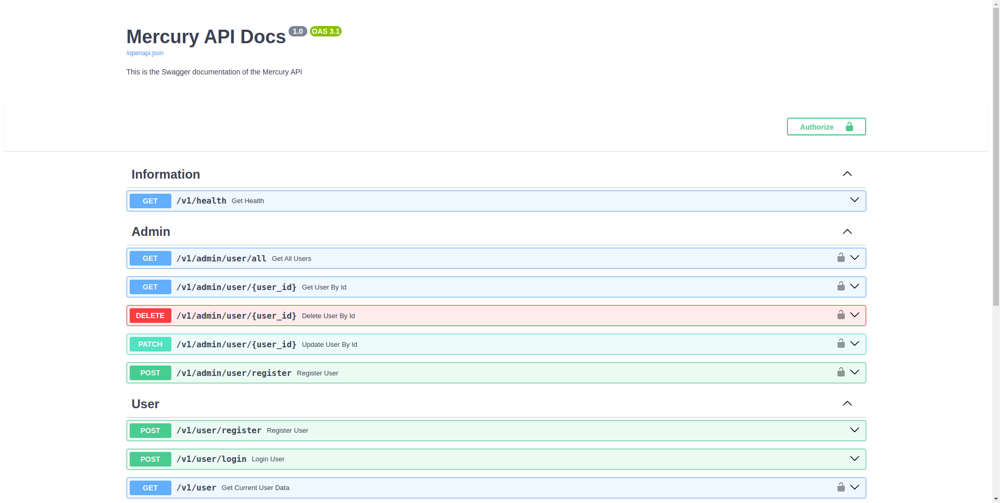

# Mercury
<p align="center">
     <br/>
    Start your Backend project faster than ever
</p>

<p align="center">
    
    
</p>

> **Solar Stack** — scaffold a customized copy with one command: see the [ecosystem map](https://github.com/ayoub3bidi/sun/blob/v1.0.0/docs/SOLAR_STACK.md)

## Table of content

* [Introduction](#Introduction)
* [Docker Hub image](#docker-hub-image)
* [Setup](#setup)
* [Test the API](#test-the-api)
* [Test the database](#test-the-database)
* [How to add new SQL migrations](#how-to-add-new-sql-migrations)
* [Integration and Unit Testing](#integration-and-unit-testing)
* [Linter](#linter)
* [Security Scan](#security-scan)

## Introduction

Mercury is a simple and reliable boilerplate that anyone can use from beginners to experts (no deep bullsh*t).   

This project uses:  
- Basic [OAuth2](https://fastapi.tiangolo.com/tutorial/security/oauth2-jwt/?h=jwt) authentication, utilizing the FastAPI security module. It also supports user authentication via Google integration.
- [PostgreSQL](https://hub.docker.com/_/postgres) as its main database, [Redis](https://hub.docker.com/_/redis) for caching, and [flyway](https://hub.docker.com/r/flyway/flyway) for database migration.
- Unit and integration tests.
- Security scanner (Bandit).

## Docker Hub image

A pre-built API image is published on Docker Hub and updated on each release:

- **Repository:** [ayoub3bidi/mercury](https://hub.docker.com/r/ayoub3bidi/mercury)
- **GHCR:** [ghcr.io/ayoub3bidi/mercury](https://ghcr.io/ayoub3bidi/mercury)

```shell
docker pull ayoub3bidi/mercury:latest
```

Use it alongside your own Postgres, Redis, and Flyway setup, or clone this repo and run the full stack with `docker compose` (see [Setup](#setup)).

### Project architecture

```
├── src
│ └── assets
│ └── constants
│ └── controllers
│     ├── admin
│     ├── user
│ └── database
│     ├── postgres_db.py
│     ├── redis_db.py
│ └── integration_tests
│ └── middleware
│     ├── auth_guard.py
│ └── migrations
│ └── models
│ └── routes
│     ├── admin
│     ├── user
│ └── schemas
│ └── unit_tests
│ └── utils
│ └── app.py
│ └── main.py
│ └── restful_ressources.py
```

## Setup
### Prerequisites

- [docker](https://www.docker.com)

### Environment variables

```shell
cp .env.dist .env
```

This will create a `.env` file in your project locally.

```shell
APP_TITLE="Mercury API Docs"
APP_DESCRIPTION="This is the Swagger documentation of the Mercury API"
APP_VERSION=0.4.0
API_URL="http://localhost:8000"
API_VERSION="v1"
APP_ENV=local
## Postgres Configuration
POSTGRES_HOST=mercury_db
POSTGRES_PASSWORD=mercury
POSTGRES_PORT=5432
POSTGRES_USER=mercury
POSTGRES_DB=mercury
POSTGRES_SIZE_POOL=30
POSTGRES_MAX_OVERFLOW=10
POSTGRES_POOL_TIMEOUT=30
POSTGRES_POOL_RECYCLE=1800
## Redis Configuration
REDIS_HOST=mercury_cache
REDIS_PORT=6379
REDIS_CACHE_DB=0
REDIS_BROKER_DB=1
## JWT Configuration
JWT_SECRET_KEY="mysecretkey"
JWT_ALGORITHM="HS256"
ACCESS_TOKEN_EXPIRE_MINUTES=30
MERCURY_AGENT_ENABLED=false
LLM_BASE_URL="http://mercury_mock_llm:9000/v1"
LLM_API_KEY="local"
RUN_TOKEN_BUDGET=256
RUN_TIMEOUT_SECONDS=60
CELERY_TASK_TIME_LIMIT=90
OTEL_ENABLED=false
OTEL_EXPORTER_OTLP_ENDPOINT="http://localhost:4317"
## OIDC Configuration
OIDC_GOOGLE_CLIENT_ID="changeme"
OIDC_GOOGLE_CLIENT_SECRET="changeme"
GOOGLE_AUTH_URL="https://accounts.google.com/o/oauth2/auth"
GOOGLE_TOKEN_URL="https://accounts.google.com/o/oauth2/token"
GOOGLE_USER_INFO_URL="https://www.googleapis.com/oauth2/v1/userinfo"
```

### Run the containers

```shell
docker compose up --build --force-recreate
```

This starts the core API, PostgreSQL, Redis, Flyway, and the local-only admin seed step. PostgreSQL uses password authentication; the sample `JWT_SECRET_KEY` is accepted only while `APP_ENV=local`. For secret files, set variables such as `JWT_SECRET_KEY_FILE=/run/secrets/jwt_secret`.

## Default admin account

For local development, the compose startup runs an idempotent seed script that creates one admin user:

| Email           | Password  |
|-----------------|-----------|
| test@admin.com  | Cloud.456 |

Get a JWT by calling `POST /v1/token` with form body `username=test@admin.com` and `password=Cloud.456`, then use the returned `access_token` as `Authorization: Bearer <token>` for admin endpoints. The seed script exits without creating an account unless `APP_ENV=local`.

## Test the API

You can check the Swagger documentation on [localhost:8000](http://localhost:8000).



```shell
curl localhost:8000/v1/health
```

This will check the health of the API. The result should be like this:

```
{"alive":true, "status":"ok"}
```

`GET /v1/health/live` reports process liveness. `GET /v1/health/ready` checks PostgreSQL and Redis and returns `503` when either is unavailable. `/v1/health` remains a compatibility alias. Prometheus metrics are available at `/metrics`. Each response includes an `X-Request-ID` header, and application logs are JSON. OpenTelemetry traces are disabled by default; set `OTEL_ENABLED=true` and configure `OTEL_EXPORTER_OTLP_ENDPOINT` to enable them.

## Optional worker and agent

The worker and agent are opt-in; test and tooling containers use a separate `test` profile.

```shell
# Core API only
docker compose up --build

# Worker without agent endpoints
docker compose --profile worker up --build

# Full local agent experience (uses the included mock OpenAI-compatible server)
MERCURY_AGENT_ENABLED=true docker compose --profile worker --profile agent up --build
```

With agent mode enabled, `POST /v1/runs` accepts a prompt and optional `token_budget`; an optional `Idempotency-Key` header prevents duplicate run creation. `GET /v1/runs/{id}` returns queued, running, completed, or failed status. The default `LLM_BASE_URL` points to the local mock. To use Ollama or another OpenAI-compatible service, set `LLM_BASE_URL` and `LLM_API_KEY` in `.env` (for Ollama on the host, use `http://host.docker.internal:11434/v1`).

Cache and Celery broker data use separate Redis databases (`REDIS_CACHE_DB=0`, `REDIS_BROKER_DB=1`), so `FLUSHDB` against the cache connection does not discard queued jobs.

## Test the database

```shell
docker compose exec mercury_db psql -U mercury -d mercury
```

This command will take inside the postgreSQL database container where you can apply any SQL command you want.

```
psql (13.13 (Debian 13.13-1.pgdg120+1))
Type "help" for help.

mercury=# \d
        List of relations
 Schema | Name | Type  |  Owner  
--------+------+-------+---------
 public | user | table | mercury
```

## How to add new SQL migrations

Flyway SQL migrations are the schema source of truth. Add a new file in `src/migrations/` with the next version number (`V{n}__description.sql`). Applied migrations are immutable; use a forward migration for changes. V3 is retained as historical migration data, V4 removes only its unchanged default admin account, and V5 creates the agent runs table.
 
```shell
CREATE TABLE IF NOT EXISTS public.test (
    id uuid DEFAULT uuid_generate_v4() PRIMARY KEY,
    name VARCHAR(200)
);
-- Name the file "V6__add_test_table.sql" after the current V5 migration.
```

If you want to know more you can check the [flyway db documentation](https://flywaydb.org).

## Integration and Unit Testing

One of important things that should be in every project is tests to keeps thing organized and make sure everything is working as intended.

### Integration tests
Here's how to run the integration test locally:  

```shell
docker compose --profile test up --build --abort-on-container-exit mercury_integration_tests
```

### Unit tests
Here's how to run the integration test locally:  

```shell
docker compose --profile test up --build --abort-on-container-exit mercury_unit_tests
```

## Linter

Having a fast linter can help avoiding coding style problems, and potentially avoid future bugs that takes long hours to fix.  
For the linter we're working with [ruff](https://astral.sh/ruff), a very fast linter written in Rust.

Here's how to run the linter test locally:

```shell
docker compose --profile test up --build --abort-on-container-exit mercury_linter
```

## Security Scan

For our project, we're using `bandit`, a tool designed to find common security issues in Python code. Here's how to run it locally:

```shell
docker compose --profile test run --build --rm mercury_security
```

## Pre-commit

Install hooks locally to catch lint issues before CI:

```shell
pip install pre-commit
pre-commit install --install-hooks
pre-commit run --all-files
```

## How to add a new endpoint

1. **Flyway migration** — add `src/migrations/V{n}__description.sql` (next version number).
2. **Model** — add or update a SQLAlchemy model in `src/models/`.
3. **Schema** — add Pydantic request/response schemas in `src/schemas/`.
4. **Controller** — implement logic in `src/controllers/`.
5. **Route** — wire the endpoint in `src/routes/` and register it in `src/restful_ressources.py`.
6. **Tests** — add coverage under `src/integration_tests/` (and `src/unit_tests/` when appropriate).

Run `./ci/integration-test.sh` after changes.

-------

## Contributions

Contributions are welcome. See [CONTRIBUTING.md](CONTRIBUTING.md), [CODE_OF_CONDUCT.md](CODE_OF_CONDUCT.md), and [SECURITY.md](SECURITY.md).

Give a star if this project helped you!
